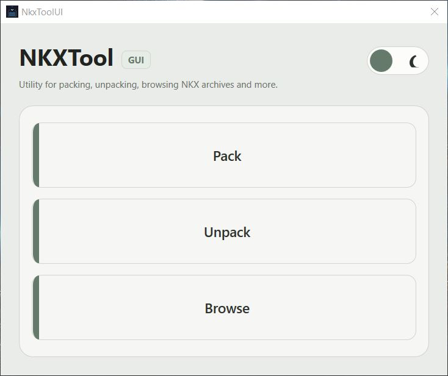
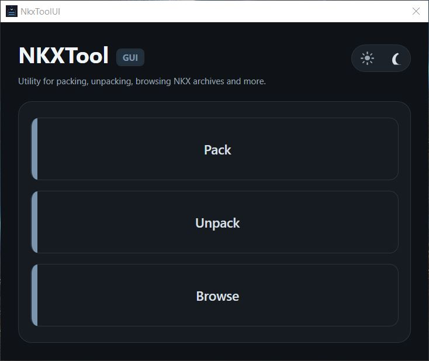

# NKXTool-UI

A lightweight desktop interface for `NkxTool.exe` to browse, create, and extract NKX and other NI archives format on Windows.

The application focuses on a clean native workflow: pack a folder, pack from a `@filelist.txt`, unpack one or more archives, browse archive contents, switch light/dark theme, and run batch multi-pack operations from a single window.

### Light Theme


### Dark Theme


## Features

- Pack a whole folder into an `.nkx` archive.
- Pack from a `@filelist.txt` with an optional root path.
- Multi-pack mode: select multiple source folders and create one archive per folder.
- Optional multi-pack behavior to include the parent folder or archive only its contents.
- Unpack one or more archives to a target folder.
- Browse archive contents before extraction.
- Live console/log output in the UI.
- Light and dark theme support.
- Configurable path to `NkxTool.exe` through `nkxtoolsettings.json`.
- **Convert Kontakt instruments (`.nki`) to Ableton Live Sampler presets (`.adv`)** – either automatically after unpacking, or from the dedicated *Convert NKI to Ableton* window.

## Requirements

- Windows
- .NET desktop runtime / SDK version 10.0
- `NkxTool.exe` available either:
  - next to the application executable, or
  - in a path configured through `nkxtoolsettings.json`

## Getting started

### 1. Clone the repository

```bash
git clone https://github.com/manzing/NKXTool-UI.git
cd NKXTool-UI
```

### 2. Build

```bash
dotnet build NkxToolUI.csproj --configuration Release
```

### 3. Run

```bash
dotnet run --project NkxToolUI.csproj
```

## Configuration

The application looks for `NkxTool.exe` from the configured path first, then from standard local locations.

Create a `nkxtoolsettings.json` file next to the application if you want to force a custom executable path:

```json
{
  "NkxToolPath": "D:\\Tools\\NkxTool\\NkxTool.exe"
}
```

UI theme preferences are stored separately in the user profile.

## Pack modes

### Pack a whole folder

Use this mode to create one archive from one source folder.

### Pack from `@filelist.txt`

Use this mode when you want precise control over the archived files. An optional root path can be passed to keep paths relative to a specific folder.

### Pack multiple folders

Use this mode to create one archive per selected source folder in a single batch.

Behavior:

- The output is a destination folder, not a single archive file.
- Each selected source folder generates its own `.nkx` archive.
- The archive name defaults to the source folder name.
- If an archive already exists, the app asks before replacing it.
- You can choose whether to include the parent folder itself or only archive its contents.

Example:

- Source folder: `library_01`
- Content inside: `samples\...`
- With **Include parent folder** enabled, the archive contains `library_01\...`
- With **Include parent folder** disabled, the archive contains `samples\...`

## Unpack

The unpack window supports selecting one or more `.nkx` archives and extracting them to a chosen destination folder.

During extraction, the output log is updated in the UI so progress can be followed without opening a terminal.

## Browse

The browse window displays the archive contents returned by `NkxTool.exe` so the structure can be inspected before extraction.

Partial extraction from the browse view is not fully implemented yet.

## Convert to Ableton Sampler

Every `.nki` instrument extracted from an NKX archive (or any other `.nki` on disk) can be turned
into an Ableton Live **Sampler** preset.

Two ways to use it:

- **While unpacking:** tick *Convert extracted NKI instruments to Ableton Sampler presets* in the
  Unpack window. After all archives are extracted, every `.nki` found in the extracted files is
  converted. The conversion runs after the whole batch, so instruments whose samples live in a
  different archive of the same batch are still resolved.
- **Standalone:** *Convert NKI to Ableton* on the main window. Add `.nki` files or whole folders
  (drag & drop works too), pick an output folder, and optionally a sample folder to search.

### What is converted

| Kontakt | Ableton Sampler |
|---|---|
| Zones: key range, velocity range, root key | Multi-sample zones (`KeyRange`, `VelocityRange`, `RootKey`) |
| Key / velocity crossfades | Zone crossfades (Kontakt fades are measured inward from the zone border) |
| Sample start / end | `SampleStart` / `SampleEnd` |
| Loops (until end / until release, alternating, crossfade, loop tuning) | Sustain loop (+ release loop mode) |
| Instrument × group × zone volume, pan and tuning | Zone volume, pan, root key + detune |
| Group key tracking | Zone tune scale (0 % or 100 %) |
| Group volume envelope (AHDSR / AHD / DBD) | Sampler amp envelope |
| Velocity → volume, pitch-bend range | *Vol < Vel*, pitch bend range |
| Round-robin / random groups | Live 12: native round robin · Live 11: Selector ranges |
| Muted / soloed groups | Respected (muted groups are left out) |
| Name, author, vendor, library, tags, credits, URL | Preset name + device *Info* text (annotation) |
| NCW compressed samples | Decoded to WAV (WAV / AIFF / FLAC are copied) |

Supported NKI flavours: Kontakt 5 / 6 / 7 / 8 (NI container format), Kontakt 4.2 and Kontakt 2 – 4.1 (XML).

### Limitations

- **Encrypted instruments** (licensed *Kontakt Player* libraries) cannot be read. They are reported in the log and skipped.
- **Monolith** instruments (samples embedded in the `.nki`) and Kontakt 1 instruments are not supported.
- Release-trigger groups are left out – Sampler cannot trigger samples on note-off.
- Scripts (KSP), effects, filters, LFOs and per-group reverse are not converted; Ableton Sampler has one global amp envelope, taken from the first regular group.
- Instruments built on synthesis or scripts rather than sample zones have nothing to convert.

### Output layout

The output folder uses the Ableton **User Library** layout:

```text
<output>/
├─ Presets/Instruments/Sampler/<Instrument>.adv
└─ Samples/Imported/<Instrument>/<sample>.wav
```

Copy both folders into your User Library (they merge with the existing `Presets` / `Samples`
folders), or drag an `.adv` file directly onto a MIDI track in Live. Samples shared by several
instruments in one conversion are written only once.

### Credits and licence of the converter

The conversion is implemented in the separate `NkiConverter` library. Its knowledge of the Kontakt
file formats and the Ableton Sampler templates are derived from
[ConvertWithMoss](https://github.com/git-moss/ConvertWithMoss) by Jürgen Moßgraber, so the
library is licensed under the **LGPL-3.0** and ships as its own assembly (`NkiConverter.dll`). See
[`NkiConverter/NOTICE.md`](NkiConverter/NOTICE.md).

Run the converter's tests with:

```bash
dotnet run --project NkiConverter.Tests/NkiConverter.Tests.csproj -c Release
```

## Project structure

```text
NKXTool-UI/
├─ Assets/
├─ Services/
├─ Themes/
├─ Views/
├─ NkiConverter/          # NKI -> Ableton Sampler conversion library (LGPL-3.0)
├─ NkiConverter.Tests/    # converter tests (dotnet run)
├─ App.xaml
├─ App.xaml.cs
├─ NKXToolUI.csproj
└─ lang.json
```

## Notes

- The app is intentionally lightweight and stays close to the CLI behavior of `NkxTool.exe`.
- Multi-language support is planned in the architecture, but not fully implemented yet.
- Theme handling and UI preferences are separate from archive tool configuration.

## Roadmap

- Partial extraction from the browse window.
- Better contextual help and tooltips for advanced pack modes.
- Expanded localization support.

